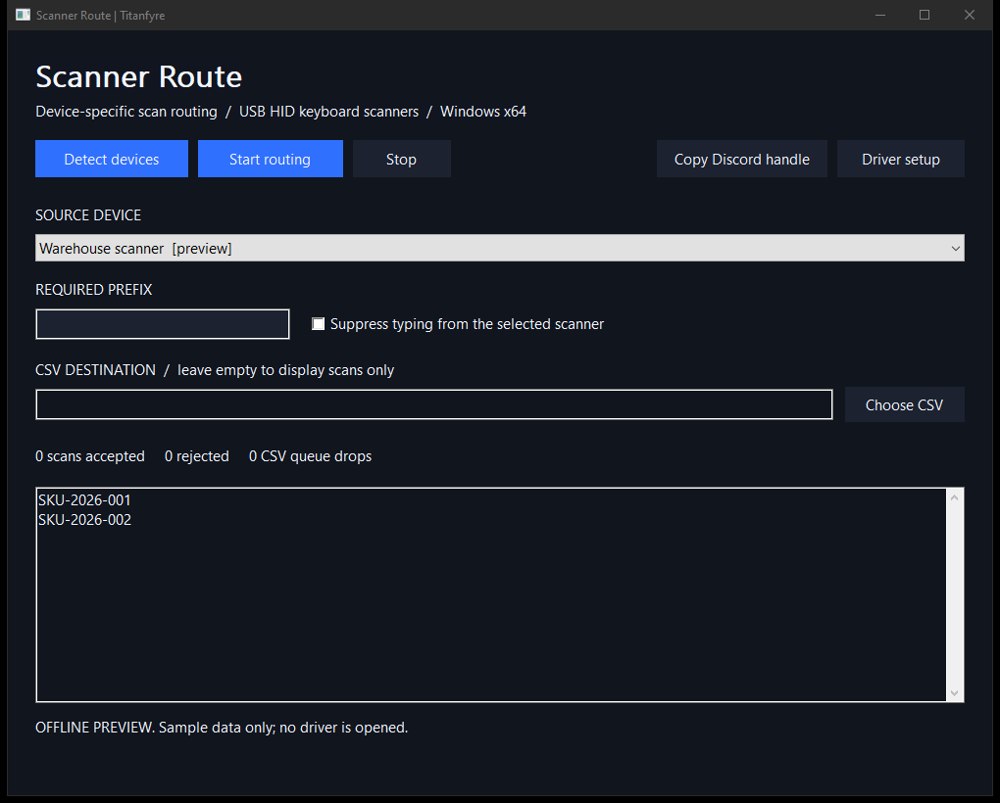

# Scanner Route

**Device-specific USB HID barcode scanner routing for Windows 10/11 x64.** Capture scans from one selected scanner, validate a prefix and append accepted values to a local CSV file while normal keyboard and mouse input keep working.



[Download Windows demo](https://github.com/titanfyre/Scanner-Route/releases/latest) · [All Titan input tools](https://github.com/titanfyre/Titan-Input-Tools)

## Install and use

1. Download and extract the complete release ZIP. Open `Dependencies/InterceptorSetup.exe`, install the **Keyboard & Mouse demo** and use Windows **Restart** if requested. Remove conflicting Interceptor editions before switching editions.
2. Open `ScannerRoute.exe` and click **Detect devices**. Approve Windows administrator elevation for live capture.
3. Select your scanner. Configure the scanner itself for a **US keyboard layout and Enter suffix**. Device selection is explicit; the app never identifies a scanner by typing speed alone.
4. Optionally set a required prefix and choose a **local CSV** destination. Click **Start routing**.
5. **Stop**, **F12** or closing the app ends capture. Unplugging or replacing the selected device stops routing; select it again after reconnecting.

The default is observation with normal typing preserved. **Suppress typing** applies only to the selected scanner while routing. Choose the correct device before enabling it. Do not use your normal keyboard as a scanner source. Devices are bound to their capture-scoped token, so a reused numeric ID cannot silently select another keyboard.

Accepted scans appear in the window; only the latest 32 are retained there. CSV writing runs separately from capture with a bounded 256-item queue. Output errors and queue drops are displayed. Values are CSV-quoted and spreadsheet-formula prefixes escaped. An unfinished scan expires after a 300 ms receive gap; a scan is limited to 1,024 ASCII characters. Capture timestamps and this timeout reflect application reception, not USB wire timing.

## Demo and commercial use

The application sources are MIT licensed. The bundled **Microsoft-signed kernel filter driver** has a **one-hour demo allowance per Windows boot**, beginning at its first capture. Restarting this application does not reset the driver allowance. The driver source is not included.

For a **production driver bundle without the demo timer**, business deployment, OEM integration or support, add **`titancsa`** on Discord: **Friends → Add Friend**, then mention **Scanner Route**. The app's **Copy Discord handle** button copies the handle. Prices and redistribution/support terms are agreed before purchase; no payment is collected by this app.

The production build uses the matching licensed Keyboard & Mouse SDK and driver. A driver key is activated using the private bundle's activation tool; a portfolio application-access key does not activate a kernel driver. Driver signing does not sign this application EXE or imply Microsoft endorsement.

## Build and verify

Visual Studio 2022 C++ tools, CMake 3.20+ and Windows SDK are required.

```powershell
.\Build.ps1
# Offline model and GUI tests; no capture, installation or activation:
.\obj\Build\Release\ScannerRoute.exe --ui-self-test
# Clearly labelled sample preview:
.\obj\Build\Release\ScannerRoute.exe --preview
```

Compile `Interceptor/Interceptor.cpp` with the app. To use your privately supplied production SDK, configure CMake with `-DSDK_DIRECTORY=PATH_TO_MATCHING_SDK`. The demo SDK files in this repository are unchanged copies of [Interceptor Keyboard & Mouse](https://github.com/TitanCSA/Interceptor-Keyboard-Mouse).

## Scope

Version 0.1 supports USB HID keyboard-wedge scanners configured for US ASCII input and Enter termination. Serial/COM scanners, arbitrary international keyboard layouts, GS1 binary control characters, network CSV shares and HTTP/ERP connectors are not implemented. Captured scan values stay local; no scanner data is sent to the administration website. Use only on systems/devices you are authorized to control. You are responsible for lawful use and applicable third-party rules. See `LICENSE` and `docs/BINARY-LICENSE.txt` for the distinct source and driver terms.
